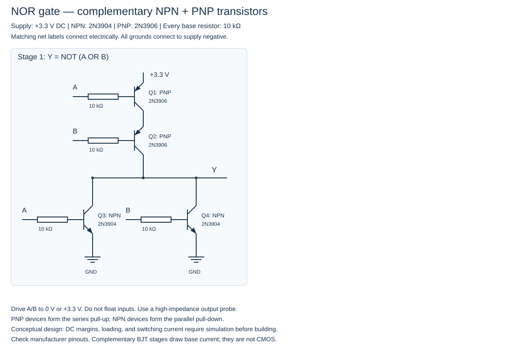

# NOR Gate Using NPN and PNP Transistors
This NOR gate requires **2 × NPN (2N3904)** and **2 × PNP (2N3906)**. Both transistor types are used in the schematic below.

This design uses **both NPN 2N3904 and PNP 2N3906 transistors** at a 3.3 V supply. Each stage is a complementary BJT NOR gate: series PNP transistors pull the output high when every input is LOW, and parallel NPN transistors pull it low when any input is HIGH. A single-input stage is an inverter.

Matching net labels connect the stages. Each input net connects to the separately resistored NPN and PNP bases bearing that label. No collector pull-up resistors are used.

## Parts

- 2 × 2N3904 NPN transistors
- 2 × 2N3906 PNP transistors
- 4 × 10 kΩ base resistors (one per transistor)
- Regulated 3.3 V supply with a common ground

## Truth table

| A | B | Y |
|---|---|---|
| 0 | 0 | 1 |
| 0 | 1 | 0 |
| 1 | 0 | 0 |
| 1 | 1 | 0 |

## Wiring and verification

Connect matching net labels and all grounds to the supply negative. Drive external inputs to 0 V or +3.3 V; never leave them floating. Check each manufacturer's transistor pinout. Use a high-impedance probe at Y; do not connect an LED or heavy load directly.

The 3.3 V supply limits reverse base-emitter stress in the series PNP network. These are complementary **bipolar** stages, not CMOS: they consume base current and may conduct through both networks during input transitions. Loading, accumulated saturation voltage drops, input thresholds, and switching current must be checked in simulation before hardware use.

The Boolean stage connections pass the truth table above. Electrical simulation and hardware testing have not been performed; these are conceptual schematics, not validated construction plans.
