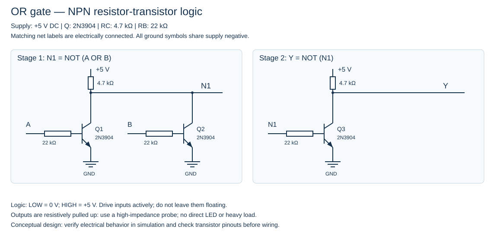

# OR Gate

This design uses NPN 2N3904 transistors and resistor-transistor logic (RTL). Each stage is a NOR gate; a single-input stage is an inverter. Matching net labels connect the stages. PNP transistors are not needed for this implementation.

## Parts

- 3 × 2N3904 NPN transistors
- 2 × 4.7 kΩ collector pull-up resistors
- 3 × 22 kΩ base resistors
- Regulated 5 V supply with a common ground

## Truth table

| A | B | Y |
|---|---|---|
| 0 | 0 | 0 |
| 0 | 1 | 1 |
| 1 | 0 | 1 |
| 1 | 1 | 1 |

## Wiring and verification

Connect matching net labels together and all grounds to the supply negative. Drive each input to 0 V or +5 V; never leave inputs floating. Check the manufacturer's transistor pinout. Measure Y with a high-impedance probe; a directly connected LED or heavy load changes the logic levels.

The Boolean stage connections have been checked against this truth table. These are conceptual schematics, not electrically simulated or hardware-tested circuits. Before building, simulate DC levels, fan-out, and switching behavior; RTL HIGH levels depend on loading.
